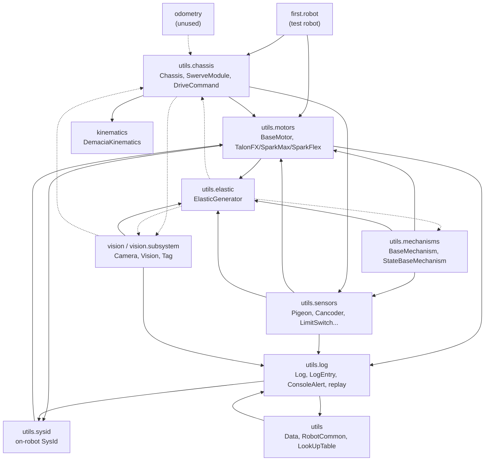
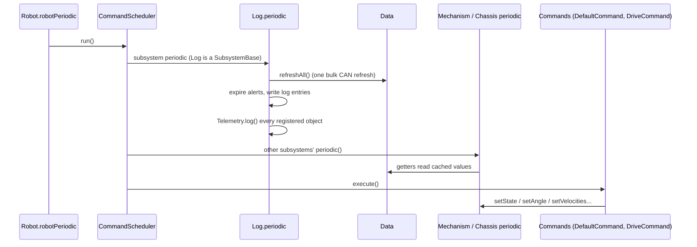
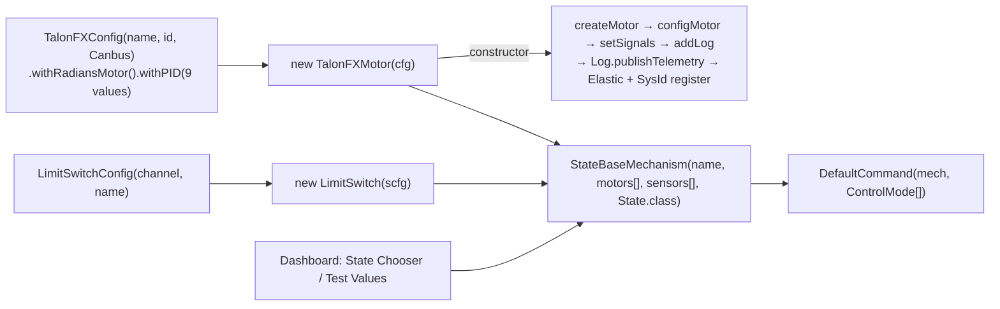
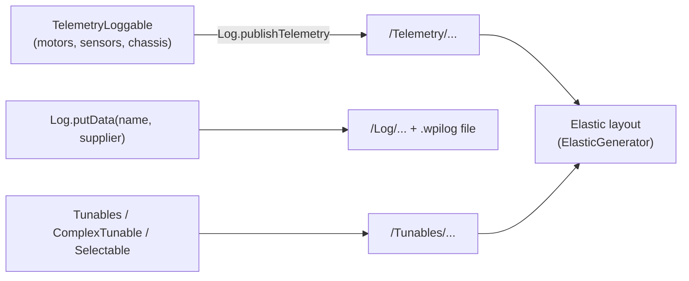

# Architecture (utils2027--Alpha7)

Diagrams are Mermaid. GitHub renders them; in VS Code install the "Markdown Preview Mermaid Support" extension (`bierner.markdown-mermaid`) and open the Markdown preview. Generated on 2026-11-02 from a codebase-memory index of `main` (81 Java files) and checked with `mmdc`. Rerun the index after big changes.

## 1. Package dependencies

An arrow means "imports". Dashed arrows are the cycles to avoid making worse.

## 2. One 20 ms loop

`Log` is one subsystem among the others, so its place in the order is not guaranteed. A subsystem whose `periodic()` runs before `Log.periodic()` reads values from the previous loop (20 ms old).

## 3. From config to a running mechanism

## 4. Dashboard data paths (2027)

