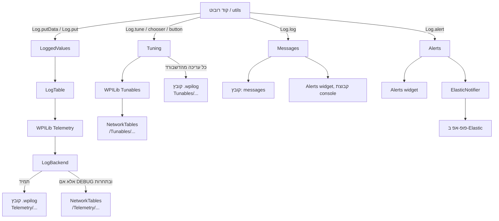

# חבילת `log` — הסבר מחלקה אחרי מחלקה

המסמך מסביר את כל המחלקות בחבילה [`first.demacia.utils.log`](../src/main/java/first/demacia/utils/log/): מה המטרה של כל אחת, איך היא עובדת, ומה עושות השורות החשובות בה. ההפניות לשורות מתייחסות לקוד בברנץ' `log-infrastructure`.

למי שרק רוצה לדעת **איך להשתמש** ב-`Log` — המסמך [log-usage-2026-vs-2027.md](log-usage-2026-vs-2027.md) מתאים יותר. המסמך הזה מסביר **מה קורה מבפנים**.

---

## 0. התמונה הכללית

### שלושה סוגי נתונים, שלושה מסלולים



- **ערכים שרק מציגים** (`putData`, `put`) עוברים דרך `Telemetry` של WPILib, ומשם ל-`LogBackend` שלנו שמחליט לאן כל ערך הולך.
- **ערכים שעורכים** (`tune`, `chooser`, `button`) עוברים דרך `Tunables` של WPILib. `Tuning` עוטף כל setter כדי שכל עריכה תירשם גם בקובץ.
- **הודעות והתראות** הולכות ל-WPILib `Alert` ולקובץ.

### למה כל כך הרבה מחלקות קטנות

כל מחלקה פנימית (`LogBackend`, `LoggedValues`, `Tuning`, `Alerts`, `Messages`) **מקבלת את כל מה שהיא צריכה בבנאי** — ה-backend, הקובץ, השעון, פונקציית האזהרה. בגלל זה אפשר לבדוק כל אחת ב-JUnit בלי רובוט, בלי HAL ובלי `DataLogManager`: הטסט נותן לה backend מדומה (`MockTelemetryBackend`), קובץ בזיכרון (`DataLogWriter` על `ByteArrayOutputStream`) ושעון שהטסט שולט בו. `Log` עצמו רק **מחבר** את החלקים.

### נקודת המבט של מי שמשתמש

רק המחלקות האלה `public`: `Log`, `Loggable`, `LogTable`, `TunableGroup`, `TuneTable`, `Chooser` (ועוד `Alerts`/`ElasticNotifier` שהם public טכנית). כל השאר `final class` בלי `public` — אי אפשר להשתמש בהן מחוץ לחבילה, וזה בכוונה: מבחוץ רואים רק את ה-API שלנו, לא את WPILib.

---

## 1. `Log` — הכניסה היחידה

[Log.java](../src/main/java/first/demacia/utils/log/Log.java)

**מטרה:** החזית (facade) של כל המערכת. כל קוד ברובוט מדבר רק איתו. הוא יוצר את כל היחידות פעם אחת, ומעביר כל קריאה ליחידה המתאימה.

### איך הוא נוצר

```java
// Log.java:96-98
static {
  start();
}
```
בלוק `static` רץ פעם אחת, בפעם הראשונה ש-Java טוענת את המחלקה `Log` — כלומר בקריאה הראשונה לכל `Log.משהו` (בדרך כלל כשהמנוע הראשון נבנה). הבלוק נמצא **אחרי** כל השדות הסטטיים בכוונה: ב-Java שדות סטטיים מאותחלים לפי סדר הופעה, ואם `start()` היה רץ קודם, אתחול שדה מאוחר יותר היה דורס את מה ש-`start()` כתב.

### `start()` — סדר האתחול, ולמה הוא חשוב ([Log.java:107-139](../src/main/java/first/demacia/utils/log/Log.java#L107-L139))

```java
DataLogManager.start();                 // 111: מתחיל לכתוב קובץ .wpilog
DataLogManager.logNetworkTables(false); // 112: לא להקליט את כל NT לקובץ (אנחנו כותבים בעצמנו)
DataLog log = DataLogManager.getLog();  // 113
DriverStation.startDataLog(log);        // 114: מצב ה-DS וג'ויסטיקים לקובץ
```
שורה 112 חשובה: אם הקלטת NT הייתה דלוקה, כל ערך היה נכתב לקובץ **פעמיים** — פעם דרך `LogBackend` ופעם דרך הקלטת NT.

```java
messages = new Messages(DataLogManager::log);                                          // 117
TelemetryRegistry.setReportWarning((path, msg) -> warnOnce("Telemetry " + path + ": " + msg)); // 119
TunableRegistry.setReportWarning(msg -> warnOnce("Tunables: " + msg));                  // 120
```
`Messages` נוצר **ראשון** כי כל אזהרה מכאן והלאה עוברת דרכו. שורות 119-120 אומרות ל-WPILib: "כשיש לך אזהרה (סוג ערך לא תואם, נתיב בלי backend) — אל תדפיס ל-stderr, תעביר אלינו". כך האזהרות מגיעות לקובץ ולדשבורד.

```java
debugPaths = new DebugPaths();                                             // 122
TelemetryRegistry.registerBackend("", LogBackend.create(                    // 123
    NetworkTableInstance.getDefault(), log, debugPaths, RobotCommon::getIsComp));
```
זו השורה שמחליפה את ה-backend ש-`RobotBase` רשם (NT בלבד) ב-`LogBackend` שלנו (NT + קובץ). הקידומת `""` אומרת "לכל הנתיבים". `RobotCommon::getIsComp` הוא **הפניה למתודה** — `LogBackend` יקרא לה בכל כתיבה כדי לדעת אם עכשיו תחרות.

```java
Consumer<String> warn = message -> log(message, Severity.WARNING);          // 126
root = new LogTable(Telemetry.getTable());                                  // 127
values = new LoggedValues(root, debugPaths, warn);                          // 128
tuning = new Tuning(TunableRegistry.getTable("/"), log, warn);              // 129
alerts = new Alerts(ElasticNotifier.networkTables(NetworkTableInstance.getDefault()),
    Timer::getTimestamp, Log::isElasticConnected, DataLogManager::log);    // 130-131
```
כל יחידה מקבלת את התלויות שלה כאן. למשל `Alerts` מקבל שעון (`Timer::getTimestamp`) ופונקציה שבודקת אם Elastic מחובר — בטסט אותן פונקציות מוחלפות בשעון ומשתנה שהטסט שולט בהם.

```java
logManager = new Log();                                       // 133: יוצר את ה-Subsystem → periodic() ירוץ
button("sysID/sysidCommand", new SysidCommand());             // 136
button("replay/LoadLatestLog", new LogReplayCommand());       // 137
RobotCommon.init();                                           // 138
```
`new Log()` נרשם אוטומטית ב-`CommandScheduler` (כי `Log extends SubsystemBase`), ולכן `periodic()` שלו ירוץ בכל לולאה. הכפתורים ו-`RobotCommon` באים **אחרונים** כי הם משתמשים ב-`tuning`, שכבר קיים.

### `periodic()` — מה קורה בכל לולאה ([Log.java:168-176](../src/main/java/first/demacia/utils/log/Log.java#L168-L176))

```java
Data.refreshAll();   // 1. מרענן את כל אותות ה-Phoenix בבת אחת (CAN יעיל)
values.update();     // 2. כל ערך ואובייקט רשום נכתב
alerts.update();     // 3. שולח פופ-אפים שחיכו ל-Elastic
synchronized (messagesLock) {
  messages.update(); // 4. מכבה הודעות קונסול שעבר זמנן
}
```
הסדר חשוב: קודם מרעננים אותות, ורק אחר כך כותבים — כך הערך שנכתב הוא מהלולאה הנוכחית.

### `log(...)` והגנה מלולאה אינסופית ([Log.java:366-381](../src/main/java/first/demacia/utils/log/Log.java#L366-L381))

```java
synchronized (messagesLock) {
  if (messages == null || writingMessage) {
    System.err.println("[Log] " + text);   // fallback
    return;
  }
  writingMessage = true;
  try {
    messages.log(text, severity);
  } finally {
    writingMessage = false;
  }
}
```
- **`synchronized`**: אזהרות של WPILib יכולות להגיע מ-thread אחר (לא מלולאת הרובוט), ו-`Messages` לא בנוי לעבודה מכמה threads במקביל. ה-lock מבטיח שרק thread אחד כותב בכל רגע.
- **`writingMessage`**: אם בזמן כתיבת הודעה WPILib מעלה אזהרה, האזהרה הייתה קוראת שוב ל-`log` → שוב אזהרה → לולאה אינסופית. הדגל שובר את המעגל: כתיבה בתוך כתיבה הולכת ל-stderr.
- **`messages == null`**: הגנה למקרה שמשהו קורא ל-`log` לפני ש-`start()` יצר את `Messages`.

### `warnOnce` ([Log.java:152-161](../src/main/java/first/demacia/utils/log/Log.java#L152-L161))

WPILib יכול להעלות את אותה אזהרה בכל לולאה (למשל ערך שנרשם פעם כ-double ופעם כ-string). `reportedWarnings` הוא Set שזוכר מה כבר דווח, כך שכל אזהרה מגיעה לקובץ פעם אחת ולא 50 פעם בשנייה.

### שאר ה-API

כל מתודה ציבורית היא שורה אחת שמעבירה ליחידה: `putData` → `values.add`, `put` → `root.put`, `tune`/`chooser`/`button` → `tuning`, `alert` → `alerts`. למשל ([Log.java:197-199](../src/main/java/first/demacia/utils/log/Log.java#L197-L199)):
```java
public static void putData(String path, Supplier<?> supplier, Dashboard level) {
  values.add(path, supplier, level);
}
```

---

## 2. `LogBackend` + `DebugPaths` — לאן כל ערך הולך

[LogBackend.java](../src/main/java/first/demacia/utils/log/LogBackend.java), [DebugPaths.java](../src/main/java/first/demacia/utils/log/DebugPaths.java)

### מה זה backend ב-WPILib 2027

כש-`Telemetry.log("motors/arm/Voltage", 3.5)` נקרא, WPILib לא יודע בעצמו לאן לכתוב. הוא שואל את ה-**registry** איזה backend אחראי על הנתיב, מבקש ממנו **entry** לנתיב (פעם אחת, ואז שומר אותו), וקורא ל-`entry.logDouble(3.5, timestamp)`. `TelemetryBackend` הוא ממשק עם שתי מתודות עיקריות: `getEntry(path)` ו-`removeEntry(path)`. `TelemetryEntry` הוא ממשק עם מתודת `log...` לכל סוג ערך.

### מה `LogBackend` עושה

הוא backend שמחזיק **שני** backends אמיתיים של WPILib ומפצל ביניהם:
```java
// LogBackend.java:55-59
static LogBackend create(NetworkTableInstance inst, DataLog log, DebugPaths debugPaths, BooleanSupplier isComp) {
  return new LogBackend(new NetworkTablesTelemetryBackend(inst, "/Telemetry"),
      new DataLogTelemetryBackend(log, "Telemetry"), debugPaths, isComp);
}
```
- `NetworkTablesTelemetryBackend(inst, "/Telemetry")` — כותב ל-NT תחת `/Telemetry`, אותו נתיב ש-`RobotBase` השתמש בו, כך ש-Elastic ו-`ElasticGenerator` לא צריכים להשתנות.
- `DataLogTelemetryBackend(log, "Telemetry")` — כותב לקובץ, עם הקידומת `Telemetry` לכל שם.

```java
// LogBackend.java:61-65
public TelemetryEntry getEntry(String path) {
  return entries.computeIfAbsent(path, p -> new Entry(
      file.getEntry(p), dashboard.getEntry(p), debugPaths.contains(p), isComp));
}
```
לכל נתיב נוצר `Entry` אחד (ונשמר ב-`ConcurrentHashMap`, כי WPILib יכול לקרוא מכמה threads). ה-`Entry` מקבל את שני ה-entries של הילדים, ו**מחליט פעם אחת** אם הנתיב הוא DEBUG.

### `Entry` — ההחלטה בכל כתיבה

```java
// LogBackend.java:119-121
private boolean toDashboard() {
  return !(debug && isComp.getAsBoolean());
}

// LogBackend.java:213-218
public void logDouble(double value, long timestamp) {
  file.logDouble(value, timestamp);       // הקובץ תמיד
  if (toDashboard()) {
    dashboard.logDouble(value, timestamp); // הדשבורד, אלא אם DEBUG ותחרות
  }
}
```
- **הקובץ מקבל תמיד.**
- **הדשבורד מקבל**, חוץ ממקרה אחד: הנתיב DEBUG **וגם** עכשיו תחרות.
- `isComp.getAsBoolean()` נקרא **בכל כתיבה**, לא פעם אחת. לכן אם מסמנים "is comp" בדשבורד באמצע ריצה, ערכי DEBUG מפסיקים להתעדכן כבר בלולאה הבאה.

אותה תבנית חוזרת לכל סוג (`logBoolean`, `logLong`, `logString`, `logDoubleArray`, `logStruct` ...). WPILib מגדיר ~20 סוגים, ולכן הקובץ ארוך — אבל זו אותה פונקציה שוב ושוב. כולל `logByte`/`logShort`/`logInt` ([שורות 172-194](../src/main/java/first/demacia/utils/log/LogBackend.java#L172-L194)): לממשק יש להן מימוש ברירת מחדל, ואם לא היינו דורסים אותן, ה-default של WPILib היה עוקף את ההחלטה שלנו.

```java
// LogBackend.java:123-126
public boolean isDiscard() {
  return file.isDiscard() && (dashboard.isDiscard() || !toDashboard());
}
```
WPILib שואל "האם בכלל לחשב את הערך?" לפני שהוא כותב (כדי לחסוך עבודה). התשובה "כן לזרוק" רק אם **אף אחד** לא ירצה אותו: הקובץ זורק, והדשבורד זורק או מוסתר.

### `DebugPaths` — האם נתיב הוא DEBUG

```java
// DebugPaths.java:28-36
boolean contains(String telemetryPath) {
  String path = normalize(telemetryPath);
  for (String debug : paths) {
    if (path.equals(debug) || path.startsWith(debug + "/")) {
      return true;
    }
  }
  return false;
}
```
- רישום של `"motors/arm"` כ-DEBUG תופס גם את `"/motors/arm/Voltage"` (כל מה שמתחתיו).
- `debug + "/"` מונע טעות קלאסית: בלי ה-`/`, הקידומת `motors/arm` הייתה תופסת גם את `motors/armExtension`.
- `normalize` ([שורות 38-44](../src/main/java/first/demacia/utils/log/DebugPaths.java#L38-L44)) מוריד `/` בסוף ומוסיף `/` בהתחלה, כי WPILib מעביר נתיבים בצורה `"/motors/arm"` ואנחנו רושמים `"motors/arm"`.
- `CopyOnWriteArraySet` — בטוח לקריאה מכמה threads (רישום קורה ממעט מקומות, קריאה קורית הרבה).

**דוגמה:**
```java
Log.putData("arm", this, Log.Dashboard.DEBUG);
// DebugPaths: {"/arm"}
// Telemetry.log של "/arm/Voltage" → contains = true
// is comp = false → קובץ + דשבורד;  is comp = true → קובץ בלבד
```

---

## 3. `Loggable`, `LogTable`, `LoggedValues` — ערכים שנכתבים בכל לולאה

### `Loggable` ([Loggable.java](../src/main/java/first/demacia/utils/log/Loggable.java))

ממשק פשוט, המקבילה שלנו ל-`TelemetryLoggable` של WPILib:
```java
public interface Loggable {
  void log(LogTable table);                  // כתוב את הערכים שלך
  default String logType() { return null; }  // אופציונלי: "Motor", "Subsystem"...
}
```
`MotorInterface` ו-`SensorInterface` יורשים ממנו, ולכן כל מנוע וחיישן הוא `Loggable`.

### `LogTable` ([LogTable.java](../src/main/java/first/demacia/utils/log/LogTable.java))

עטיפה דקה ל-`TelemetryTable` של WPILib, כדי שקוד מחוץ לחבילה לא יראה את טיפוסי WPILib. הבנאי package-private ([שורה 12](../src/main/java/first/demacia/utils/log/LogTable.java#L12)) — רק החבילה יוצרת טבלאות, והקוד בחוץ רק מקבל אותן.

ה-`put` הגנרי ([שורות 114-137](../src/main/java/first/demacia/utils/log/LogTable.java#L114-L137)) הוא החלק המעניין:
```java
public <T> void put(String name, T value) {
  if (value == null) {
    return;                                   // ערך null פשוט לא נכתב
  }
  if (value instanceof double[] array) {
    table.log(name, array);
  } else if ...                               // float[], long[], int[], boolean[], String[]
  } else if (value instanceof Object[] array) {
    table.log(name, array);                   // מערכי struct (Pose2d[]) ומערכים "עטופים"
  } else {
    table.log(name, value);                   // Double, Boolean, String, Pose2d, ...
  }
}
```
**למה כל ה-`instanceof`:** ה-`log(String, T)` הגנרי של WPILib בודק Boolean, Double, String, Struct וכו' — **אבל אין לו ענף למערכים**, אז מערך היה נופל ל-`value.toString()` ונכתב כטקסט כמו `"[D@1a2b"`. זה היה באג אמיתי שנמצא בביקורת. `value instanceof double[] array` הוא pattern matching של Java: בודק את הטיפוס **וגם** יוצר משתנה `array` מהטיפוס הנכון, וכך Java בוחר את ה-overload הנכון `log(String, double[])`.

```java
// LogTable.java:144-146
public void recordEveryLoop(String name) {
  table.keepDuplicates(name);
}
```
בדרך כלל WPILib **לא כותב** ערך שלא השתנה מהפעם הקודמת (חוסך מקום בקובץ). `keepDuplicates` מבטל את זה לערך אחד. משתמשים בזה לארבעת האותות ש-SysId צריך (ראו `BaseMotor` למטה).

### `LoggedValues` ([LoggedValues.java](../src/main/java/first/demacia/utils/log/LoggedValues.java))

**מטרה:** רשימת כל הדברים שנרשמו ב-`Log.putData`, וכתיבה של כולם פעם בלולאה.

```java
// LoggedValues.java:17
private final Map<String, Consumer<LogTable>> entries = new LinkedHashMap<>();
```
כל רישום נשמר כ"פונקציה שכותבת לטבלה" (`Consumer<LogTable>`). `LinkedHashMap` שומר את סדר הרישום, אז הכתיבה תמיד באותו סדר.

**רישום ערך (Supplier):**
```java
// LoggedValues.java:33-35
void add(String path, Supplier<?> supplier, Log.Dashboard level) {
  register(path, level, table -> table.put(path, supplier.get()));
}
```

**רישום אובייקט (Loggable):**
```java
// LoggedValues.java:44-53
register(path, level, table -> {
  LogTable objectTable = table.table(path);   // תת-טבלה: "motors/arm"
  String type = loggable.logType();
  if (type != null) {
    objectTable.setType(type);                // ".type" = "Motor", בשביל הדשבורד
  }
  loggable.log(objectTable);                  // המנוע כותב "Position", "Voltage"...
});
```
המנוע כותב `table.put("Position", ...)` בלי לדעת איפה הוא. `table.table(path)` כבר "מיקם" אותו תחת `motors/arm`, אז הערך מגיע ל-`Telemetry/motors/arm/Position`.

**`register` ([שורות 81-89](../src/main/java/first/demacia/utils/log/LoggedValues.java#L81-L89)):**
```java
if (level == Log.Dashboard.DEBUG) {
  debugPaths.add(path);           // לפני כל כתיבה! LogBackend מחליט DEBUG ביצירת ה-entry
}
if (entries.put(path, writer) != null) {
  warn.accept("Log path " + path + " was registered twice; ...");
}
```
`entries.put` מחזיר את הערך הקודם — אם הוא לא `null`, הנתיב כבר היה רשום, והחדש מחליף אותו (עם אזהרה).

**`update` ([שורות 66-79](../src/main/java/first/demacia/utils/log/LoggedValues.java#L66-L79)) — עמידות לתקלות:**
```java
for (Map.Entry<String, Consumer<LogTable>> entry : new LinkedHashMap<>(entries).entrySet()) {
  try {
    entry.getValue().accept(root);
  } catch (RuntimeException e) {
    if (warned.add(entry.getKey())) {
      StackTraceElement[] trace = e.getStackTrace();
      String where = trace.length > 0 ? " at " + trace[0] : "";
      warn.accept("Failed to log " + entry.getKey() + ": " + e + where);
    }
  }
}
```
- **`new LinkedHashMap<>(entries)`** — עוברים על **עותק**. אם `log()` של אובייקט רושם נתיב חדש בזמן ריצה, שינוי של ה-map המקורי באמצע הלולאה היה זורק `ConcurrentModificationException`.
- **`try/catch` לכל נתיב בנפרד** — Supplier אחד שזורק (למשל `NullPointerException`) לא עוצר את שאר הערכים ולא מפיל את הרובוט.
- **`warned.add`** — מחזיר `true` רק בפעם הראשונה, אז האזהרה נכתבת פעם אחת ולא 50 פעם בשנייה.
- **`trace[0]`** — השורה בקוד שזרקה, כדי שתלמיד ימצא את הבאג (למשל `at first.robot.Arm.getAngle(Arm.java:42)`).

---

## 4. `Tuning`, `TuneTable`, `TunableGroup`, `Chooser` — ערכים שעורכים מהדשבורד

### איך Tunables של WPILib עובדים

`TimedRobot` קורא ל-`TunableRegistry.update()` בכל לולאה. העדכון קורא מה הדשבורד שינה, ואם השתנה ערך — קורא ל-**setter** שנתנו לו. הדשבורד מציג את הערך העדכני דרך ה-**getter**.

### `Tuning` ([Tuning.java](../src/main/java/first/demacia/utils/log/Tuning.java)) — הטריק: לעטוף את ה-setter

```java
// Tuning.java:45-50
void number(String path, DoubleSupplier getter, DoubleConsumer setter) {
  String key = normalize(path);
  if (claim(key)) {
    root.publishDouble(key, getter, recordingNumber(key, setter));
  }
}
```
ל-WPILib לא מעבירים את ה-setter של המשתמש, אלא **setter עטוף** מ-`recordingNumber`:
```java
// Tuning.java:129-140
DoubleConsumer recordingNumber(String key, DoubleConsumer setter) {
  return value -> {
    try {
      setter.accept(value);          // 1. מפעיל את ה-setter האמיתי
    } catch (RuntimeException e) {
      warnRejected(key, e);          //    זרק? אזהרה, ולא רושמים
      return;
    }
    numberEntries.computeIfAbsent(key, k -> new DoubleLogEntry(file, "Tunables/" + k))
        .append(value);              // 2. רק אם הצליח — רושמים לקובץ
  };
}
```
- הערך נרשם לקובץ **רק אחרי** שה-setter הצליח. אם ה-setter דחה ערך לא חוקי (זרק), הקובץ לא ירשום ערך שלא באמת נכנס לשימוש.
- `computeIfAbsent` יוצר את ה-`DoubleLogEntry` בקובץ רק בעריכה הראשונה. ערך שאף פעם לא נערך לא תופס entry בקובץ.
- כאן כותבים ישירות ל-`DataLog` (לא דרך Telemetry), כי זה הקובץ בלבד — לא צריך להציג שוב בדשבורד.

**`claim` — מניעת כפילות ([שורות 121-127](../src/main/java/first/demacia/utils/log/Tuning.java#L121-L127)):**
```java
boolean claim(String normalizedPath) {
  if (paths.add(normalizedPath)) {
    return true;
  }
  warn.accept("Tunable already published, keeping the first: " + normalizedPath);
  return false;
}
```
`Set.add` מחזיר `false` אם הנתיב כבר קיים. פרסום כפול לאותו נתיב מתעלם מהשני ומזהיר (הראשון נשאר).

**קבוצה (`group`, [שורות 76-92](../src/main/java/first/demacia/utils/log/Tuning.java#L76-L92)):**
```java
root.publish(key, new ComplexTunable() {
  public String getTunableType() { return type; }          // "PID+FF Config"
  public void publishTunable(TunableTable table) {
    group.tune(new TuneTable(table, key, Tuning.this));    // הלמבדה של המשתמש
  }
});
```
`ComplexTunable` הוא מה ש-WPILib מבין. אנחנו יוצרים אחד "על המקום" (מחלקה אנונימית) שכשמבקשים ממנו לפרסם את עצמו, מריץ את הלמבדה של המשתמש עם `TuneTable` שלנו.

**כפתור ושדה ([שורות 106-118](../src/main/java/first/demacia/utils/log/Tuning.java#L106-L118)):** `Command` ו-`Field2d` כבר מממשים `ComplexTunable` ב-WPILib 2027, אז פשוט מפרסמים אותם. `Command` מפרסם ילד בשם `running`: הדשבורד שם `true` → הפקודה מתוזמנת; ה-getter הוא `isScheduled()`, אז כשהפקודה נגמרת הכפתור חוזר ל-`false` לבד.

### `TunableGroup` + `TuneTable` ([TunableGroup.java](../src/main/java/first/demacia/utils/log/TunableGroup.java), [TuneTable.java](../src/main/java/first/demacia/utils/log/TuneTable.java))

`TunableGroup` הוא ממשק פונקציונלי (`@FunctionalInterface`) — בגלל זה אפשר לכתוב למבדה `t -> {...}`. `TuneTable` הוא מה ש-`t` מקבל:
```java
// TuneTable.java:30-35
public void number(String name, DoubleSupplier getter, DoubleConsumer setter) {
  String childPath = path + "/" + name;               // "motors/arm/PID+FF config slot 0/KP"
  if (tuning.claim(childPath)) {
    table.publishDouble(name, getter, tuning.recordingNumber(childPath, setter));
  }
}
```
הוא משתמש באותו `recordingNumber` של `Tuning`, אז גם ילדים של קבוצה נרשמים לקובץ (`Tunables/motors/arm/PID+FF config slot 0/KP`).

**דוגמה מלאה** (מ-[BaseMotor.java](../src/main/java/first/demacia/utils/motors/BaseMotor.java)):
```java
Log.tune("motors/" + getName() + "/Motion Magic Config", "Motion Magic Config", t -> {
  t.number("Vel", () -> config.maxVelocity, v -> config.maxVelocity = v);
  t.button("Update", configMotionMagicCmd);
});
```
בדשבורד: קבוצה עם `Vel` (מספר) ו-`Update` (כפתור). שינוי `Vel` ל-3.0 → `config.maxVelocity = 3.0` + שורה בקובץ `Tunables/motors/<שם>/Motion Magic Config/Vel = 3.0`.

### `Chooser` ([Chooser.java](../src/main/java/first/demacia/utils/log/Chooser.java))

עוטף את `Selectable` של WPILib. הבעיה: `Selectable` מחזיר רק את **הערך** שנבחר, אבל לקובץ רוצים לרשום את **השם** (`"VOLTAGE"`, לא `ControlMode@3f2a`). הפתרון:
```java
// Chooser.java:13, 15
private record Option<T>(String name, T value) {}
private final Selectable<Option<T>> selectable = new Selectable<>();
```
`record` הוא מחלקה קטנה שמחזיקה שני שדות. כל אפשרות נשמרת כזוג (שם, ערך), כך שכשמשהו נבחר יש את שניהם:
```java
// Chooser.java:19-28
selectable.onChange(option -> {
  try {
    if (listener != null) {
      listener.accept(option.value());     // למשתמש: הערך
    }
    recordSelection.accept(option.name()); // לקובץ: השם
  } catch (RuntimeException e) {
    warn.accept(e);
  }
});
```

---

## 5. `Alerts` + `ElasticNotifier` — התראות ופופ-אפים

### `Alerts` ([Alerts.java](../src/main/java/first/demacia/utils/log/Alerts.java))

**מטרה:** `Log.alert("Arm hot", temp > 80)` שאפשר לקרוא בכל לולאה בלי להציף כלום.

**זיהוי קצה ([שורות 91-108](../src/main/java/first/demacia/utils/log/Alerts.java#L91-L108)):**
```java
Entry entry = entries.get(message);                // ההודעה היא המזהה
if (entry == null) {
  if (entries.size() >= MESSAGE_LIMIT) {           // 50
    raiseOverflow(message);
    return;
  }
  entry = new Entry(message, Log.Severity.WARNING, "", Alert.Level.MEDIUM);
  entries.put(message, entry);
}
boolean risingEdge = active && !entry.active;     // היה false, עכשיו true
entry.active = active;
entry.alert.set(active);                          // ה-widget של Alerts מתעדכן תמיד (זול)
if (risingEdge) {
  fileLog.accept("[ALERT - " + entry.severity.name() + "] " + message);
  showPopup(entry);                               // שורה בקובץ ופופ-אפ — רק ברגע המעבר
}
```
**"עלייה" (rising edge)** = הרגע שבו התנאי עובר מ-`false` ל-`true`. גם אם התנאי נכון 3000 לולאות ברצף, יש שורה אחת בקובץ ופופ-אפ אחד. כשהתנאי נהיה `false` ואז שוב `true`, זו עלייה חדשה.

**למה הגבלה של 50:** הקוד מזהה התראה לפי הטקסט שלה. קוד כמו `Log.alert("temp is " + temp, true)` יוצר טקסט חדש בכל לולאה → התראה חדשה בכל לולאה → זליגת זיכרון. אחרי 50 טקסטים שונים, `raiseOverflow` ([שורות 154-167](../src/main/java/first/demacia/utils/log/Alerts.java#L154-L167)) מקפיץ **פעם אחת** התראת שגיאה שמסבירה את הבעיה, ומתעלם מהשאר בשקט (בדיקת `overflow == null` מבטיחה שזה קורה פעם אחת).

**פופ-אפים שמחכים ל-Elastic ([שורות 121-138](../src/main/java/first/demacia/utils/log/Alerts.java#L121-L138), [169-180](../src/main/java/first/demacia/utils/log/Alerts.java#L169-L180)):**
```java
private void showPopup(Entry entry) {
  if (isElasticReady()) {
    entry.notifyElastic();
  } else if (!pending.contains(entry)) {
    pending.add(entry);        // Elastic לא מוכן: לחכות
  }
}

private boolean isElasticReady() {
  return !Double.isNaN(elasticConnectedSince)
      && clockSeconds.getAsDouble() - elasticConnectedSince >= POPUP_CONNECT_DELAY;  // 2 שניות
}
```
**הבעיה שזה פותר:** התראה כמו "CAN ID לא חוקי" קופצת בבנאי של מנוע, כשהרובוט עולה — Elastic עוד לא מחובר, והפופ-אפ היה הולך לאיבוד. גם מיד אחרי ש-Elastic מתחבר, לוקח לו רגע להירשם לטופיק של הפופ-אפים. לכן ממתינים עד ש-Elastic מחובר **שתי שניות רצוף**, ו-`update()` שולח את כל מה שחיכה — רק אם התנאי עדיין נכון (`if (entry.active)`), כי אין טעם להקפיץ התראה שכבר נפתרה.

`elasticConnectedSince` הוא `NaN` ("לא מספר") כשאין חיבור — דרך לסמן "לא מחובר" בלי משתנה נוסף. כשהחיבור נופל ([שורה 123](../src/main/java/first/demacia/utils/log/Alerts.java#L123)) הוא חוזר ל-`NaN`, והספירה של שתי השניות מתחילה מחדש בחיבור הבא.

**`notifyElastic` ([שורות 57-64](../src/main/java/first/demacia/utils/log/Alerts.java#L57-L64)):** לא שולח את אותה התראה פעמיים בתוך שנייה (`MIN_NOTIFICATION_INTERVAL`), למקרה של תנאי שמהבהב סביב הסף.

### `ElasticNotifier` ([ElasticNotifier.java](../src/main/java/first/demacia/utils/log/ElasticNotifier.java))

Elastic מאזין לטופיק NT בשם `/Elastic/RobotNotifications` ומצפה ל-JSON. הממשק מגדיר "משהו שמציג פופ-אפ"; המימוש האמיתי ([שורות 27-32](../src/main/java/first/demacia/utils/log/ElasticNotifier.java#L27-L32)):
```java
StringPublisher publisher = inst.getStringTopic("/Elastic/RobotNotifications")
    .publish(PubSubOption.SEND_ALL, PubSubOption.KEEP_DUPLICATES);
return (severity, title, description, displaySeconds) ->
    publisher.set(toJson(severity, title, description, displaySeconds));
```
- `SEND_ALL` — לשלוח כל ערך, גם אם נשלחו כמה באותה לולאה (בלי זה NT שולח רק את האחרון).
- `KEEP_DUPLICATES` — לשלוח גם אם ה-JSON זהה לקודם (אותה התראה פעמיים).
- המימוש הוא למבדה — בטסט מחליפים אותו ב-notifier מזויף שרק זוכר מה נשלח.

**`escape` ([שורות 51-71](../src/main/java/first/demacia/utils/log/ElasticNotifier.java#L51-L71)):** הודעה עם `"` או `\` הייתה שוברת את ה-JSON (`{"title":"say "hi""}` לא חוקי). הפונקציה מחליפה `"` ב-`\"` וכו', כך שכל טקסט מייצר JSON תקין.

---

## 6. `Messages` + `ConsoleAlert` + `ConsoleConstants` — `Log.log`

[Messages.java](../src/main/java/first/demacia/utils/log/Messages.java), [ConsoleAlert.java](../src/main/java/first/demacia/utils/log/ConsoleAlert.java), [ConsoleConstants.java](../src/main/java/first/demacia/utils/log/ConsoleConstants.java)

**מטרה:** `Log.log("arm ready")` — שורה בקובץ (`messages`), והודעה בווידג'ט ה-Alerts בקבוצה `console`.

```java
// Messages.java:31-52
ConsoleAlert log(String text, Log.Severity severity) {
  fileLog.accept(text);                                 // תמיד לקובץ

  for (int i = 0; i < active.size(); i++) {             // כבר מוצגת הודעה עם אותו טקסט?
    ConsoleAlert existing = active.get(i);
    if (existing.getText().equals(text)) {
      existing.setText(text);                           // מאפס את הטיימר שלה
      active.remove(i);
      active.add(existing);                             // מעביר לסוף (= הכי חדשה)
      return existing;
    }
  }

  ConsoleAlert alert = new ConsoleAlert(text, level(severity));
  alert.set(true);
  while (active.size() >= ConsoleConstants.CONSOLE_LIMIT) {  // 10
    active.remove(0).close();                           // סוגר את הכי ישנה
  }
  active.add(alert);
  return alert;
}
```
- **שימוש חוזר בהודעה זהה:** WPILib מרשה רק התראה חיה אחת לכל טקסט בקבוצה, וגם אין טעם להציג את אותה שורה 10 פעמים.
- **`active` כתור:** ההודעה הישנה ביותר באינדקס 0. כשיש 10, הישנה נסגרת לפני שמוסיפים חדשה — לכל היותר 10 בבת אחת.
- `existing.setText(text)` עם אותו טקסט נראה מיותר, אבל `ConsoleAlert.setText` גם **מאפס את הטיימר** שלה ([ConsoleAlert.java:51-55](../src/main/java/first/demacia/utils/log/ConsoleAlert.java#L51-L55)).

`ConsoleAlert` היא `Alert` של WPILib עם טיימר: `isTimerOver()` אומר אם עבר `CONSOLE_MESSEGE_TIME`. `update()` ([Messages.java:55-64](../src/main/java/first/demacia/utils/log/Messages.java#L55-L64)) סוגר הודעות שעבר זמנן. ב-`ConsoleConstants` הזמן הוא `0`, שפירושו "לא לפוג אף פעם" (רק המגבלה של 10 מנקה).

`ConsoleAlert` מייצרת `id` ייחודי לכל התראה (`"console" + nextId++`), כי ב-2027 כל `Alert` חייבת `id` ייחודי בקבוצה.

---

## 7. `LogReader`, `LogReplay`, `LogReplayCommand`, `LogFileChooser` — קריאת קבצי לוג

### `LogReader` ([LogReader.java](../src/main/java/first/demacia/utils/log/LogReader.java))

**מטרה:** לקרוא קובץ `.wpilog` ולהחזיר את הנתונים מקובצים לפי "הורה" — בשביל SysId ו-Replay. רץ גם על הרובוט וגם במחשב (`SysidApp`), ולכן **לא קורא ל-`Log`** (במחשב אין רובוט ו-`Log` היה מנסה להפעיל את כל המערכת).

**פורמט הקובץ בקצרה:** אחרי כותרת, הקובץ הוא רצף "רשומות". רשומה עם `id = 0` היא רשומת בקרה ("נפתח entry מספר 7 בשם X מסוג double"); כל רשומה אחרת היא ערך ל-entry לפי ה-id שלו.

```java
// LogReader.java:193-200 — קריאת כותרת רשומה
int headerByte = dataInputStream.readUnsignedByte();
int idLength = (headerByte & 0x3) + 1;            // 2 ביטים: כמה בייטים ל-id
int payloadLength = (headerByte >> 2 & 0x3) + 1;  // 2 ביטים: כמה בייטים לגודל
int timestampLength = (headerByte >> 4 & 0x7) + 1;// 3 ביטים: כמה בייטים לזמן
```
הפורמט חוסך מקום: מספר קטן נכתב בבייט אחד. הבייט הראשון אומר כמה בייטים יש לכל שדה. `& 0x3` שומר את 2 הביטים התחתונים, ו-`>> 2` מזיז ימינה כדי להגיע לביטים הבאים.

**קיבוץ לפי הורה ([שורות 358-370](../src/main/java/first/demacia/utils/log/LogReader.java#L358-L370)):**
```java
if (filter.test(info) && !name.startsWith(REPLAY_PREFIX)) {
  ...
  fieldName = name.substring(name.lastIndexOf('/') + 1);   // "Position"
  groupName = name.substring(0, name.lastIndexOf('/'));     // "Telemetry/motors/arm"
  groups.computeIfAbsent(groupName, key -> new ArrayList<>()).add(newEntry);
}
```
`Telemetry/motors/arm/Position`, `.../Velocity`, `.../Voltage` נכנסים כולם לקבוצה `Telemetry/motors/arm` — בדיוק מה ש-SysId צריך: "כל הנתונים של מנוע אחד". ערכים תחת `Telemetry/replay/` מדולגים, כדי ש-Replay לא יקרא את מה שהוא עצמו כתב.

**`EOFException` ([שורות 178-191](../src/main/java/first/demacia/utils/log/LogReader.java#L178-L191)):** הקריאה רצה עד שהקובץ נגמר, ואז Java זורק `EOFException` — כך יודעים שסיימנו. הרשומה האחרונה נקראת במלואה גם אם היא קצרה (בניגוד לבאג שמצאנו ב-`DataLogIterator` של WPILib, שמדלג על רשומה אחרונה קצרה מ-16 בייט).

**איפה הקובץ על הרובוט ([שורה 126](../src/main/java/first/demacia/utils/log/LogReader.java#L126)):** `new File(DataLogManager.getLogDir())` — התיקייה ש-WPILib באמת כותב אליה ב-2027 (`/home/systemcore/logs`, או `/u/logs` עם USB). קודם הקוד חיפש ב-`/home/lvuser/logs`, ו-SysId על הרובוט לא היה מוצא אף קובץ.

**דוגמת שימוש** (מ-`SysidCommand`):
```java
Map<String, List<Entry>> groups =
    LogReader.getGroups(true, info -> info.name().startsWith("Telemetry/motors/"));
// groups.get("Telemetry/motors/arm") → [Position, Velocity, Acceleration, Voltage, ...]
```

### למה מנוע קורא ל-`recordEveryLoop`

SysId לוקח את ארבעת האותות ומצמיד אותם **לפי אינדקס**: הדגימה ה-i של Position עם ה-i של Velocity וכו'. WPILib מדלג על ערכים שלא השתנו, כך שאם המתח קבוע (למשל בבדיקת "dynamic"), Voltage היה מקבל פחות דגימות מ-Position, והאינדקסים היו זזים. `recordEveryLoop` ([BaseMotor.java](../src/main/java/first/demacia/utils/motors/BaseMotor.java)) מבטיח שלכל ארבעתם יש דגימה בכל לולאה — בסימולציה יצא בדיוק 1961 דגימות לכל אחד.

### `LogReplay` + `LogReplayCommand` ([LogReplay.java](../src/main/java/first/demacia/utils/log/LogReplay.java), [LogReplayCommand.java](../src/main/java/first/demacia/utils/log/LogReplayCommand.java))

**מטרה:** "להריץ אחורה" לוג: לטעון קובץ, ולהציג בדשבורד את הערכים כפי שהיו בזמן נבחר.

- הכפתור `replay/LoadLatestLog` (מ-`Log.start()`) מריץ את `LogReplayCommand`, שקורא ל-`LogReplay.loadLogs()` ופועל גם כשהרובוט disabled (`runsWhenDisabled` מחזיר `true`).
- `loadLogs` ([שורות 112-170](../src/main/java/first/demacia/utils/log/LogReplay.java#L112-L170)):
  1. מוחק רישומי replay קודמים (`Log.remove`) — כדי שלחיצה שנייה לא תיצור ~150 אזהרות "נרשם פעמיים".
  2. קורא את הקובץ האחרון עם `LogReader`, רק ערכים תחת `Telemetry/`.
  3. לכל ערך: יוצר `ReplayEntry` ורושם אותו ב-`Log.putData("replay/" + נתיב, ...)` עם Supplier מהסוג המתאים (boolean, מספר, מערך או טקסט).
- `Log.tune("replay/time", ...)` ([שורה 100](../src/main/java/first/demacia/utils/log/LogReplay.java#L100)) — מספר שעורכים בדשבורד: הזמן לנגן. שינוי שלו קורא ל-`setReplayTime`, שמעדכן כל `ReplayEntry` לערך שהיה בזמן הזה (חיפוש בינארי ברשימת הדגימות).

### `LogFileChooser` ([LogFileChooser.java](../src/main/java/first/demacia/utils/log/LogFileChooser.java))

חלון בחירת קובץ (Swing) בשביל `SysidApp` במחשב. ברירת המחדל היא תיקיית הלוגים הציבורית של WPILib במחשב. לא השתנה בעבודה הזו.

---

## 8. מחלקות מחוץ לחבילה שקשורות ללוג

### `Data` ([Data.java](../src/main/java/first/demacia/utils/Data.java))

עטיפה לאותות CTRE (`StatusSignal`) או ל-Supplier. התפקיד שנשאר לה: **לרענן את כל אותות ה-Phoenix בבת אחת** (`refreshAll`, נקרא בתחילת `Log.periodic()`), כי בקשה אחת לכל האותות יעילה בהרבה מבקשה לכל אות. המנועים יוצרים `new Data<>(motor.getPosition(), isRio())` ומשתמשים בה לקרוא ערכים. הקיבוץ למערכים (`"Float/..."`), זיהוי השינויים והחותמת זמן נמחקו — את זה WPILib עושה עכשיו בעצמו.

### `RobotCommon` ([RobotCommon.java](../src/main/java/first/demacia/utils/RobotCommon.java))

מחזיק `isRed` ו-`isComp`. מתפרסם כקבוצה שעורכים:
```java
Log.tune("RC", "RobotCommon", t -> {
  t.flag("is red", RobotCommon::getIsRed, RobotCommon::setIsRed);
  t.flag("is comp", RobotCommon::getIsComp, RobotCommon::setIsComp);
});
```
`is comp` הוא המתג שקובע אם ערכי DEBUG מוצגים בדשבורד — `LogBackend` קורא `RobotCommon::getIsComp` בכל כתיבה.

### `BaseMotor` — הדוגמה המלאה

```java
// בבנאי
Log.putData("motors/" + name, this);                                         // אובייקט, כל לולאה
Log.tune("motors/" + name + "/test Value", this::getTestValue, this::setTestValue);

// log(LogTable) — נקרא בכל לולאה מ-LoggedValues
table.put("Position", getCurrentPosition());
table.put("Voltage", getCurrentVoltage());
table.put("CloseLoopSP", getCurrentClosedLoopSP());
table.recordEveryLoop("Position");   // SysId
table.recordEveryLoop("Voltage");    // SysId

@Override
public String logType() { return "Motor"; }
```
בקובץ: `Telemetry/motors/<שם>/Position`, `.../Voltage`, `.../.type = "Motor"`, ואם ערכו את `test Value` מהדשבורד גם `Tunables/motors/<שם>/test Value`.

---

## 9. שלושה תרחישים מההתחלה עד הסוף

### א. ערך מנוע בלולאה אחת
1. `CommandScheduler` מריץ את `Log.periodic()`.
2. `Data.refreshAll()` מבקש מה-CAN את כל אותות ה-Phoenix.
3. `LoggedValues.update()` מגיע לרישום `"motors/arm"` → `table.table("motors/arm")` → `BaseMotor.log(table)`.
4. `table.put("Voltage", 6.0)` → `TelemetryTable.log` → WPILib מבקש entry לנתיב `/motors/arm/Voltage` → `LogBackend.getEntry` (בפעם הראשונה; אחר כך שמור).
5. `Entry.logDouble(6.0)` → הקובץ: `Telemetry/motors/arm/Voltage`. הדשבורד: `/Telemetry/motors/arm/Voltage`, אלא אם DEBUG ובתחרות.

### ב. עריכה מהדשבורד
1. מישהו משנה ב-Elastic את `/Tunables/motors/arm/test Value` ל-1.5.
2. `TimedRobot` קורא ל-`TunableRegistry.update()` → WPILib רואה את השינוי → קורא ל-setter **העטוף** מ-`Tuning.recordingNumber`.
3. העטיפה קוראת ל-`setTestValue(1.5)`. הצליח → `DoubleLogEntry("Tunables/motors/arm/test Value").append(1.5)`.
4. בבדיקת הסימולציה יצא בדיוק זה: `Tunables/motors/Front Left Steer/test Value = 1.5`.

### ג. התראה כשהרובוט עולה
1. בבנאי של מנוע: `Log.alert("bad CAN id")` → עלייה → שורה בקובץ → `showPopup`: Elastic לא מחובר → `pending`.
2. Elastic מתחבר → `Alerts.update()` מתחיל לספור.
3. אחרי 2 שניות של חיבור רצוף → `update()` שולח את הפופ-אפ (התנאי עדיין נכון) → JSON ל-`/Elastic/RobotNotifications` → פופ-אפ על המסך.
